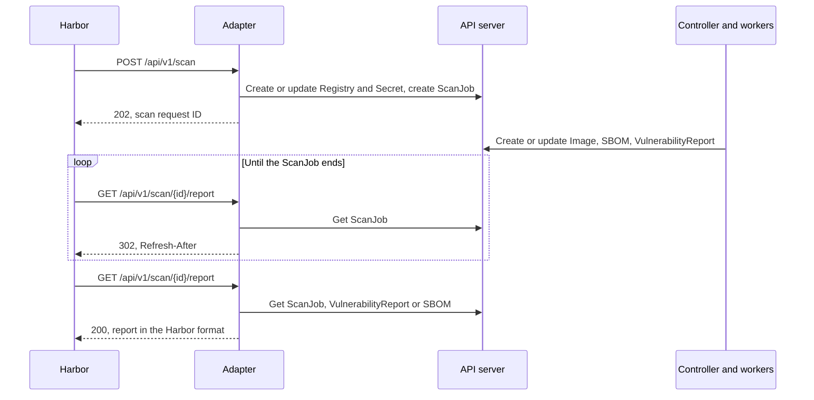

|              |                                 |
| :----------- | :------------------------------ |
| Feature Name | Harbor Scanner Adapter          |
| Start Date   | 2026-11-12                      |
| Category     | Architecture                    |
| RFC PR       | [fill this in after opening PR] |
| State        | **ACCEPTED**                    |

# Summary

[summary]: #summary

This RFC adds a Harbor scanner adapter to SBOMscanner.
[Harbor](https://goharbor.io) is a container registry that can send its images to an external scanner.
An adapter is an HTTP service that translates the requests of Harbor into operations on that scanner.

The adapter in this RFC keeps one `Registry` and one `Secret` for each image that Harbor sends.
It creates one `ScanJob` for each scan request.
Then it translates the `VulnerabilityReport` and `SBOM` resources into the report formats of Harbor.

This RFC covers only the case where Harbor and SBOMscanner run in the same Kubernetes cluster.

# Motivation

[motivation]: #motivation

Harbor shows vulnerability data in its UI and uses this data in its policies.
For example, a Harbor project can refuse to serve an image that has vulnerabilities above a given severity.
Harbor gets this data from a scanner through the [Pluggable Scanner API](https://github.com/goharbor/pluggable-scanner-spec).

A user who runs Harbor and SBOMscanner in the same cluster operates two scanners today.
Each scanner has its own vulnerability database and its own results.
The two sets of results can differ.

SBOMscanner also supports VEX documents.
A VEX (Vulnerability Exploitability eXchange) document states that a vulnerability does not affect a product.
The `VEXHub` resources of SBOMscanner have no effect on the results that Harbor shows.

The expected outcome is:

- Harbor uses SBOMscanner as its scanner
- The Harbor UI and the Harbor policies use the results of SBOMscanner
- The VEX configuration of SBOMscanner applies to the results that Harbor shows
- The user operates one scanner and one vulnerability database

## Examples / User Stories

[examples]: #examples

- As a Harbor administrator, I want to register SBOMscanner as a scanner in Harbor, so that Harbor shows the results of SBOMscanner.
- As a developer, I want Harbor to scan my pushed image with SBOMscanner, so that the Harbor UI shows its vulnerabilities.
- As a Harbor administrator, I want the "scan all" schedule of Harbor to use SBOMscanner, so that the results stay current.
- As a security engineer, I want Harbor to store the SBOM that SBOMscanner generates, so that I can download the SBOM from Harbor.
- As a security engineer, I want my `VEXHub` resources to apply to the Harbor results, so that Harbor does not block images for suppressed vulnerabilities.
- As a cluster operator, I want the adapter to be an optional component, so that clusters without Harbor do not run it.

# Detailed design

[design]: #detailed-design

## Scope

This RFC includes:

- A new component, the adapter, that implements version 1.2 of the Pluggable Scanner API
- The vulnerability scan capability and the SBOM capability of that API
- Harbor and SBOMscanner in the same Kubernetes cluster

This RFC does not include:

- A Harbor that runs outside the cluster of SBOMscanner
- Changes to the `Registry` and `ScanJob` CRDs

## How Harbor uses a scanner adapter

### Unit of a scan request

Harbor sends one scan request for one manifest digest.
A digest is the SHA-256 hash that identifies an image manifest.
Harbor does not send a request for a repository or for a project.

A scan request contains these fields:

| Field                    | Content                                                         |
| :----------------------- | :-------------------------------------------------------------- |
| `registry.url`           | The URL of the Harbor registry                                  |
| `registry.authorization` | The credentials to pull the image, as an `Authorization` header |
| `artifact.repository`    | The repository, for example `library/nginx`                     |
| `artifact.digest`        | The digest of the manifest                                      |
| `artifact.tag`           | A tag of the image. This field can be empty                     |
| `artifact.mime_type`     | The media type of the manifest                                  |
| `enabled_capabilities`   | The requested capability: `vulnerability` or `sbom`             |

Other rules apply:

- A multi-arch image is an index that points to one manifest for each platform.
  If the adapter does not declare support for index media types, Harbor sends one scan request for each platform manifest.
- A vulnerability scan and an SBOM generation for the same digest are two scan requests.
- Harbor sends only the artifacts that it classifies as images.
  Harbor does not send signatures and other attachments.
- Harbor does not start a second vulnerability scan for a digest while the first scan runs.

### Events that start a scan request

| Event                                                          | Scan requests that the adapter receives              |
| :------------------------------------------------------------- | :--------------------------------------------------- |
| Push, with "scan on push" enabled in the project               | One `vulnerability` request for the pushed image     |
| Push, with "generate SBOM on push" enabled in the project      | One `sbom` request for the pushed image              |
| A user starts a scan of one image in the UI or through the API | One request of the selected type                     |
| An administrator starts "scan all"                             | One `vulnerability` request for each image in Harbor |
| The schedule of "scan all" fires                               | One `vulnerability` request for each image in Harbor |

"Scan all" scans each image again.
Harbor does not skip an image that already has a report.

Harbor does not send a request when the vulnerability database changes, since the vulnerability database is
managed by the external scanner. Harbor has no knowledge about it.
Harbor does not tell the adapter that a user deleted an image.
The API has no operation to cancel a scan.

### Credentials

Harbor creates one robot account for each scan request.
A robot account is a Harbor account for automated access.
The robot account can pull only from the project of the image.
Harbor deletes the robot account when the scan ends.

By default, Harbor sends the name and the secret of the robot account as HTTP Basic credentials.

### Registry URL

Harbor sends its own URL in the `registry.url` field of each scan request.
The adapter has no configuration value for this URL.

Harbor can send one of two URLs:

- The external URL of Harbor. This is the default
- The URL of the internal Kubernetes service of Harbor

The Harbor administrator selects one of the two for each scanner.
The administrator cannot enter a different URL.
The installation of Harbor defines both values.

### Report retrieval

After the scan request, Harbor polls the adapter for the report.
The adapter answers `302` until the report is ready.
The `Refresh-After` header of the `302` answer tells Harbor when to ask again.

Two limits of the Harbor client affect the adapter:

- The Harbor client stops each HTTP call to the adapter after 5 seconds
- The Harbor client reads `Refresh-After` as an 8-bit integer, so the maximum value is 127 seconds

## Architecture

The adapter is a new binary, `cmd/harbor-adapter`.
The Helm chart deploys it as a `Deployment` with a `Service`.
The chart disables the adapter by default, as it does for the MCP server.

The adapter does not scan images.
It creates resources through the Kubernetes API server, and the existing controller and workers do the scan.
The adapter keeps no state in memory.
All the state of a scan request is in Kubernetes resources, so the adapter can restart and can run with many replicas.



## Resources

The adapter keeps one `Registry` and one `Secret` for each image.
An image is one digest in one repository of one Harbor registry.
The adapter creates one `ScanJob` for each scan request.

As a result, a new scan of the same image uses the existing `Registry`.
The workers then reuse the `Image` and the `SBOM` of that `Registry`, and do not pull the image again.

The adapter creates all the resources in one namespace, the artifacts namespace.
The artifacts namespace is a dedicated namespace, and its default name is `sbomscanner-harbor`.
The section [Permissions of the adapter](#permissions-of-the-adapter) gives the reason.

### Names

| Resource   | Name                                                 |
| :--------- | :--------------------------------------------------- |
| `Registry` | `harbor-<SHA-256 of "<host>/<repository>@<digest>">` |
| `Secret`   | The same name as the `Registry`                      |
| `ScanJob`  | `harbor-<UUID>`. The adapter generates the UUID      |

The `<host>` part is the host and the port of `registry.url`.

The name of the `Registry` is deterministic.
The adapter calculates the name from the scan request and does not search for the `Registry`.
The workload scan feature names its `Registry` resources in the same way, with the hash of the registry host.

A scan request from Harbor contains no ID.
The adapter generates a UUID for each new `ScanJob`.
The name of the `ScanJob` is the scan request ID.
The adapter returns this ID in the `202` answer, and Harbor sends it in each report call.

### Example

This section uses the following scan request as an example:

```json
{
  "registry": {
    "url": "https://core.harbor.domain",
    "authorization": "Basic <name and secret of the robot account, in Base64>"
  },
  "artifact": {
    "repository": "library/nginx",
    "digest": "sha256:6c3c624b58dbbcd3c0dd82b4c53f04194d1247c6eebdaab7c610cf7d66709b3b",
    "tag": "1.27",
    "mime_type": "application/vnd.oci.image.manifest.v1+json"
  },
  "enabled_capabilities": [
    {
      "type": "vulnerability",
      "produces_mime_types": [
        "application/vnd.security.vulnerability.report; version=1.1"
      ]
    }
  ]
}
```

The adapter calculates the SHA-256 of this text:

```
core.harbor.domain/library/nginx@sha256:6c3c624b58dbbcd3c0dd82b4c53f04194d1247c6eebdaab7c610cf7d66709b3b
```

If the `Registry` with this name does not exist, the adapter creates it.
The `Registry` targets one digest in one repository:

```yaml
apiVersion: sbomscanner.kubewarden.io/v1alpha1
kind: Registry
metadata:
  name: harbor-a15b220f69aaf34a7e582fc4a26c99ef2e59c197cc122bc2ebe00ee07fb93124
  namespace: sbomscanner-harbor
  labels:
    sbomscanner.kubewarden.io/harbor-adapter: "true"
spec:
  uri: core.harbor.domain
  catalogType: NoCatalog
  authSecret: harbor-a15b220f69aaf34a7e582fc4a26c99ef2e59c197cc122bc2ebe00ee07fb93124
  insecure: false
  caBundleRef:
    configMap:
      name: harbor-ca
  repositories:
    - name: library/nginx
      matchOperator: Or
      matchConditions:
        - name: tag-sha256:6c3c624b58dbbcd3c0dd82b4c53f04194d1247c6eebdaab7c610cf7d66709b3b
          expression: tag == "sha256:6c3c624b58dbbcd3c0dd82b4c53f04194d1247c6eebdaab7c610cf7d66709b3b"
```

The fields of the `Registry` have these sources:

| Field               | Source                                                                      |
| :------------------ | :-------------------------------------------------------------------------- |
| `spec.uri`          | The host and the port of `registry.url`                                     |
| `spec.insecure`     | `true` when `registry.url` starts with `http://`                            |
| `spec.caBundleRef`  | The `harborAdapter.caBundleRef` value of the Helm chart. Not set by default |
| `spec.repositories` | `artifact.repository`, with one match condition for `artifact.digest`       |
| `spec.scanInterval` | Not set. Harbor decides when a scan runs                                    |
| `spec.platforms`    | Not set. The digest identifies one platform                                 |

The `caBundleRef` field is necessary only when a private CA signed the certificate of Harbor.
The user creates the referenced ConfigMap or Secret in the artifacts namespace.

The adapter sets `matchOperator: Or` because the exact reference path requires this value.
The section [Exact references in the catalog handler](#exact-references-in-the-catalog-handler) describes this path.

The `Secret` contains the credentials of the scan request:

```yaml
apiVersion: v1
kind: Secret
metadata:
  name: harbor-a15b220f69aaf34a7e582fc4a26c99ef2e59c197cc122bc2ebe00ee07fb93124
  namespace: sbomscanner-harbor
  ownerReferences:
    - apiVersion: sbomscanner.kubewarden.io/v1alpha1
      kind: Registry
      name: harbor-a15b220f69aaf34a7e582fc4a26c99ef2e59c197cc122bc2ebe00ee07fb93124
      uid: <UID of the Registry>
type: kubernetes.io/dockerconfigjson
stringData:
  .dockerconfigjson: |
    {
      "auths": {
        "core.harbor.domain": {
          "username": "<name of the robot account>",
          "password": "<secret of the robot account>"
        }
      }
    }
```

The adapter decodes `registry.authorization` to get the name and the secret of the robot account.
The key under `auths` is the same as `spec.uri` of the `Registry`.
The `Registry` is the owner of the `Secret`, so Kubernetes deletes the `Secret` with the `Registry`.

Harbor creates a new robot account for each scan request.
As a result, the adapter writes the new credentials into the `Secret` at each scan request.
The workers need these credentials also for a later scan, because they contact the registry before they reuse the `SBOM`.

The `ScanJob` references the `Registry`:

```yaml
apiVersion: sbomscanner.kubewarden.io/v1alpha1
kind: ScanJob
metadata:
  name: harbor-3fa85f64-5717-4562-b3fc-2c963f66afa6
  namespace: sbomscanner-harbor
spec:
  registry: harbor-a15b220f69aaf34a7e582fc4a26c99ef2e59c197cc122bc2ebe00ee07fb93124
```

The controller and the workers then create one `Image`, one `SBOM`, and one `VulnerabilityReport` for the `Registry`.
The `imageMetadata.registry` field of these resources contains the name of the `Registry`.
The `imageMetadata.tag` field contains the digest, as it does for workload scan images that use a digest.

A later scan of the same image creates no new `Image` and no new `SBOM`.
It updates the `VulnerabilityReport`.
An `sbom` request for an image that has an `SBOM` starts no scan.

### Label of the adapter resources

The adapter does not set the `app.kubernetes.io/managed-by: sbomscanner` label.
The `Registry` webhook permits only the service account of the controller to set that label.

The adapter cannot use the `sbomscanner.kubewarden.io/workloadscan` label. That's because
the workload scan reconciler deletes a `Registry` with that label when no workload uses its images.

The adapter sets a new label, `sbomscanner.kubewarden.io/harbor-adapter: "true"`.
The adapter uses this label to find the resources that it must delete.

### Scan requests for the same image at the same time

SBOMscanner permits one active `ScanJob` for each `Registry`.
A `ScanJob` is active when it is not complete and not failed.

If a scan request arrives while the `Registry` has an active `ScanJob`, the adapter creates no new `ScanJob`.
The adapter returns the name of the active `ScanJob` as the scan request ID.
Harbor then gets the result of that `ScanJob` for the two scan requests.

The two scan requests then have the same scan request ID.
This causes no confusion, because each report call names the report that it wants.
Harbor sends the media type of the report in the `Accept` header of the call.

This case occurs when a Harbor project has "scan on push" and "generate SBOM on push" enabled.
One scan then gives the vulnerability report and the SBOM.

## HTTP API

The adapter serves three operations of the Pluggable Scanner API.
All the paths start with `/api/v1`.

### GET /metadata

Harbor calls this operation when an administrator registers the adapter.
The adapter does not call the API server for this operation.

```json
{
  "scanner": {
    "name": "SBOMscanner",
    "vendor": "Kubewarden",
    "version": "<version of SBOMscanner>"
  },
  "capabilities": [
    {
      "type": "vulnerability",
      "consumes_mime_types": [
        "application/vnd.oci.image.manifest.v1+json",
        "application/vnd.docker.distribution.manifest.v2+json"
      ],
      "produces_mime_types": [
        "application/vnd.security.vulnerability.report; version=1.1"
      ]
    },
    {
      "type": "sbom",
      "consumes_mime_types": [
        "application/vnd.oci.image.manifest.v1+json",
        "application/vnd.docker.distribution.manifest.v2+json"
      ],
      "produces_mime_types": [
        "application/vnd.security.sbom.report+json; version=1.0"
      ],
      "additional_attributes": {
        "sbom_media_types": ["application/spdx+json"]
      }
    }
  ],
  "properties": {
    "harbor.scanner-adapter/scanner-type": "os-package-vulnerability"
  }
}
```

Three decisions are in this answer:

- The adapter does not declare index media types.
  SBOMscanner can scan an index, but Harbor stores and checks the results for each platform manifest.
  If the adapter declares the index types, Harbor sends one scan request for the index and the platform manifests get no report.
  Harbor then refuses the pull of a multi-arch image when the project blocks vulnerable images.
  The Trivy adapter of Harbor makes the same choice.
- The adapter declares only the SPDX format for the SBOM, because SBOMscanner stores SPDX documents.
- The adapter does not set the property that selects Bearer credentials.
  As a result, Harbor sends Basic credentials, and these fit a `dockerconfigjson` secret.

### POST /scan

The adapter does these steps:

1. Make sure that the body is valid.
   If the JSON is not valid, answer `400`.
   If a field is not valid, answer `422`.
2. Calculate the name of the `Registry`.
3. If the request is an `sbom` request and the `SBOM` of the image exists, start no scan.
   Answer `202` with the name of the most recent complete `ScanJob` of the `Registry`.
4. If the `Registry` does not exist, create it.
5. Create the `Secret`, or update it with the credentials of the scan request.
6. If the `Registry` has an active `ScanJob`, answer `202` with the name of that `ScanJob`.
7. Create the `ScanJob`.
8. Answer `202` with the name of the new `ScanJob`.

In step 3, the adapter starts no scan, because the SBOM of a digest does not change.
The adapter also does not change the `Secret` in step 3.
Harbor deletes the robot account of this scan request when it gets the SBOM, and an active `ScanJob` of the image can need the credentials in the `Secret`.
If the `Registry` has no complete `ScanJob`, the adapter continues with step 4.

To find the `ScanJob` resources of a `Registry`, the adapter lists them with the field selector `spec.registry=<name of the Registry>`.

Two scan requests for the same image can arrive at the same moment.
If the `ScanJob` webhook rejects the `ScanJob` in step 7 because a different `ScanJob` is active, the adapter does step 6 again.

If a different step fails, the adapter answers `500`.
The adapter does not delete the `Registry` in this case.
The garbage collector deletes the `Registry` later if no scan request uses it.

The adapter does not wait for the scan in this operation.
Harbor stops the call after 5 seconds.

### GET /scan/{scan_request_id}/report

The adapter gets the `ScanJob` with the name `scan_request_id`.
Then it answers from the state of the `ScanJob`:

| State of the `ScanJob`                         | Answer                                    |
| :--------------------------------------------- | :---------------------------------------- |
| Not found                                      | `404`                                     |
| Not complete and not failed                    | `302` with a `Refresh-After` header       |
| `Failed`                                       | `500` with the message of the condition   |
| `Complete`, with the reason `NoImagesToScan`   | `500` with a message that names the cause |
| `Complete`, with the reason `AllImagesScanned` | `200` with the report                     |

The `NoImagesToScan` case occurs when SBOMscanner does not see the artifact as a container image.

For the `200` answer, the adapter reads the name of the `Registry` from `spec.registry` of the `ScanJob`.
Then the `Accept` header selects the report:

- For `application/vnd.security.vulnerability.report; version=1.1`, the adapter lists the `VulnerabilityReport` resources with the field selector `imageMetadata.registry=<name of the Registry>`.
  Then it translates the result.
- For `application/vnd.security.sbom.report+json; version=1.0`, the adapter lists the `SBOM` resources with the same field selector.
  The query parameter `sbom_media_type` must be `application/spdx+json`.
  If it is not, the adapter answers `400`.
- For other media types, the adapter answers `501`.

A later scan of the same image updates the `VulnerabilityReport`.
As a result, the report can come from a more recent `ScanJob` than the one in the request.

## Translation of the vulnerability report

Harbor parses the report into its own data model.
Harbor rejects a report that it cannot parse.
As a result, the adapter cannot return the `VulnerabilityReport` resource as it is.

The top-level fields have these sources:

| Field of the Harbor report | Source                                                             |
| :------------------------- | :----------------------------------------------------------------- |
| `generated_at`             | `status.completionTime` of the `ScanJob`                           |
| `artifact`                 | `imageMetadata.repository` and `imageMetadata.digest`              |
| `scanner`                  | The same values as in the metadata answer                          |
| `severity`                 | The highest severity in the list. `Unknown` when the list is empty |
| `vulnerabilities`          | One flat list, built from all the entries of `report.results`      |

Each vulnerability has these sources:

| Field of the Harbor report | Source in the `VulnerabilityReport`                                                  |
| :------------------------- | :----------------------------------------------------------------------------------- |
| `id`                       | `cve`                                                                                |
| `package`                  | `packageName`. For the `binary` class, `packagePath`                                 |
| `version`                  | `installedVersion`                                                                   |
| `fix_version`              | The items of `fixedVersions`, joined with `, `                                       |
| `severity`                 | `severity`, changed from `CRITICAL` to `Critical`, and so on                         |
| `description`              | `description`. If it is empty, `title`                                               |
| `links`                    | `references`                                                                         |
| `preferred_cvss`           | The entry of `cvss` for `severitySource`, with the score as a number                 |
| `cwe_ids`                  | `cwes`                                                                               |
| `vendor_attributes`        | `purl`, `diffID`, the full `cvss` map, and the target, class, and type of the result |

Other rules apply:

- The adapter omits the vulnerabilities that have `suppressed: true`.
  A VEX document suppressed these vulnerabilities.
  As a result, the Harbor policies do not block an image for them.
- Harbor identifies a vulnerability by its ID, package, and version, and keeps one entry for each identity.
  The adapter removes the duplicates before it sends the report.
- Harbor counts a vulnerability as fixable when `fix_version` is not empty.
- SBOMscanner stores no CVSS version 2 data, so the adapter omits the version 2 fields.

### Example of a translation

This example shows one result with two vulnerabilities.
A VEX document suppressed the second vulnerability.

The values of the first vulnerability come from `examples/vulnerabilityreport.yaml`.
We shortened the long values, and we added the `severitySource` field and the second vulnerability.

The `VulnerabilityReport` contains this data:

```yaml
imageMetadata:
  repository: library/nginx
  digest: sha256:6c3c…
report:
  results:
    - class: os-pkgs
      type: alpine
      target: alpine 3.11.3
      vulnerabilities:
        - cve: CVE-2022-37434
          packageName: zlib
          installedVersion: 1.2.11-r3
          fixedVersions: ["1.2.11-r4"]
          severity: CRITICAL
          severitySource: nvd
          cvss:
            nvd:
              {
                v3score: "9.8",
                v3vector: "CVSS:3.1/AV:N/AC:L/PR:N/UI:N/S:U/C:H/I:H/A:H",
              }
            redhat:
              {
                v3score: "7",
                v3vector: "CVSS:3.1/AV:N/AC:H/PR:N/UI:N/S:U/C:L/I:L/A:H",
              }
          cwes: ["CWE-787", "CWE-120"]
          purl: pkg:apk/alpine/zlib@1.2.11-r3?arch=x86_64&distro=3.11.3
          diffID: sha256:5216…
          description: zlib through 1.2.12 has a heap-based buffer over-read…
          references: ["https://nvd.nist.gov/vuln/detail/CVE-2022-37434"]
          suppressed: false
        - cve: CVE-2020-28928
          packageName: musl
          installedVersion: 1.1.24-r0
          severity: MEDIUM
          suppressed: true
```

The adapter returns this report to Harbor:

```json
{
  "generated_at": "2026-11-12T10:00:00Z",
  "artifact": { "repository": "library/nginx", "digest": "sha256:6c3c…" },
  "scanner": {
    "name": "SBOMscanner",
    "vendor": "Kubewarden",
    "version": "<version of SBOMscanner>"
  },
  "severity": "Critical",
  "vulnerabilities": [
    {
      "id": "CVE-2022-37434",
      "package": "zlib",
      "version": "1.2.11-r3",
      "fix_version": "1.2.11-r4",
      "severity": "Critical",
      "description": "zlib through 1.2.12 has a heap-based buffer over-read…",
      "links": ["https://nvd.nist.gov/vuln/detail/CVE-2022-37434"],
      "preferred_cvss": {
        "score_v3": 9.8,
        "vector_v3": "CVSS:3.1/AV:N/AC:L/PR:N/UI:N/S:U/C:H/I:H/A:H"
      },
      "cwe_ids": ["CWE-787", "CWE-120"],
      "vendor_attributes": {
        "purl": "pkg:apk/alpine/zlib@1.2.11-r3?arch=x86_64&distro=3.11.3",
        "diffID": "sha256:5216…",
        "class": "os-pkgs",
        "type": "alpine",
        "target": "alpine 3.11.3",
        "cvss": {
          "nvd": {
            "v3score": "9.8",
            "v3vector": "CVSS:3.1/AV:N/AC:L/PR:N/UI:N/S:U/C:H/I:H/A:H"
          },
          "redhat": {
            "v3score": "7",
            "v3vector": "CVSS:3.1/AV:N/AC:H/PR:N/UI:N/S:U/C:L/I:L/A:H"
          }
        }
      }
    }
  ]
}
```

The example shows these changes:

- The vulnerability is in a flat list, and the class, type, and target of its result are in `vendor_attributes`.
- The suppressed vulnerability, CVE-2020-28928, is not in the report.
- `CRITICAL` becomes `Critical`, and the top-level `severity` is the highest severity in the list.
- `preferred_cvss` uses the `nvd` entry, because `severitySource` is `nvd`, and the score is a number.
- The `fixedVersions` list becomes one text value.

## Translation of the SBOM report

The `spdx` field of the `SBOM` resource becomes the `sbom` field of the Harbor report without changes.
The `media_type` field is `application/spdx+json`.
The `generated_at`, `artifact`, and `scanner` fields have the same sources as in the vulnerability report.

Harbor then stores the SPDX document in its own registry, as an attachment of the image.

## Cleanup

The adapter keeps the resources of an image after a scan, because a later scan of the same image reuses them.
The `SBOM` is the resource that saves the most time, because the workers do not pull the image again.

No other component of SBOMscanner deletes the `Registry` resources of the adapter, so the adapter runs a garbage collector.

Each 15 minutes, the garbage collector lists the `Registry` resources with the adapter label in the artifacts namespace.
It deletes each `Registry` that got no scan request during the retention time.
The `harborAdapter.retention` value of the Helm chart sets the retention time.
The default is 36 hours.

The retention time starts at the `metadata.creationTimestamp` of the most recent `ScanJob` of the `Registry`.
If the `Registry` has no `ScanJob`, the retention time starts at the `metadata.creationTimestamp` of the `Registry`.

The owner references then delete the `Secret`, `ScanJob`, `Image`, `SBOM`, and `VulnerabilityReport` resources of the `Registry`.

The retention time must be longer than the time between two scans of the same image.
With the default, a "scan all" that runs each day keeps the resources of all the images in Harbor.
When a user deletes an image from Harbor, Harbor sends no more scan requests for it.
The garbage collector then deletes the `Registry` of that image.

The adapter does not delete `ScanJob` resources.
The controller keeps the 10 most recent `ScanJob` resources of each `Registry` and deletes the older ones.

If Harbor asks for the report of a `ScanJob` that does not exist, the adapter answers `404`.
Harbor then records the scan as failed.

Each replica of the adapter runs the garbage collector.
A delete of a resource that does not exist is not an error.

## Communication between Harbor and the adapter

Harbor authenticates to the adapter with a Bearer token.
The Harbor administrator enters the token in the registration of the scanner.
The adapter reads the token from a `Secret`, as the MCP server does for its credentials.
The adapter rejects a request without the correct token before it calls the API server.

The adapter serves HTTPS with a certificate from cert-manager, as the other components do.

The token does not stop a process in the cluster that sends many requests to the adapter.
A `NetworkPolicy` that permits connections to the adapter only from Harbor prevents this problem.
The chart does not create this `NetworkPolicy`, because its selectors depend on how Harbor is deployed.
The documentation of the adapter must explain how an administrator creates it.

## Permissions of the adapter

The adapter creates its resources in the artifacts namespace.
The artifacts namespace is a dedicated namespace, and it is not the namespace of SBOMscanner.
The default name is `sbomscanner-harbor`.
The chart creates this namespace.

The adapter has a `Role` in the artifacts namespace only:

| Resources                       | Verbs                             |
| :------------------------------ | :-------------------------------- |
| `secrets`                       | `create`, `update`                |
| `registries`                    | `create`, `get`, `list`, `delete` |
| `scanjobs`                      | `create`, `get`, `list`           |
| `vulnerabilityreports`, `sboms` | `get`, `list`                     |

The adapter has no permissions in the namespace of SBOMscanner.

The dedicated namespace is necessary because of the `secrets` rule.
Kubernetes cannot limit the `create` verb to resource names, and the names of the adapter resources are not known in advance.
As a result, the adapter can create and replace each `Secret` in the namespace of its `Role`.
The namespace of SBOMscanner contains TLS certificates and credentials of the other components.
In a dedicated namespace, the adapter can change only the `Secret` resources that it created.

The adapter cannot read a `Secret`.
The workers already have the permission to read secrets in all namespaces.

The `Secret` of an image contains the credentials of the robot account of the most recent scan request.
Harbor deletes that robot account when that scan ends.

When a user removes the chart, Helm deletes the artifacts namespace and all the resources of the adapter.
This is acceptable, because Harbor keeps its own copy of the reports.

## Helm chart values

The chart gets a new `harborAdapter` block:

| Value                              | Purpose                                                      |
| :--------------------------------- | :----------------------------------------------------------- |
| `harborAdapter.enabled`            | Deploys the adapter. The default is `false`                  |
| `harborAdapter.artifactsNamespace` | The artifacts namespace. The default is `sbomscanner-harbor` |
| `harborAdapter.auth.secretName`    | The `Secret` with the Bearer token                           |
| `harborAdapter.caBundleRef`        | The CA bundle for the Harbor registry                        |
| `harborAdapter.retention`          | The retention time. The default is 36 hours                  |

## Harbor configuration

The Harbor administrator does these steps:

1. In Harbor, open "Interrogation Services" and add a new scanner.
2. Set the endpoint to the URL of the adapter `Service`.
3. Set the authorization to "Bearer" and enter the token.
4. Set the new scanner as the default scanner.

## Changes to the existing components

### Exact references in the catalog handler

A `Registry` that the adapter creates must select one image by its digest.
The catalog handler cannot do this today for such a `Registry`, so this RFC changes the handler.

#### The problem

The catalog handler selects images by tag.
For each repository, the handler does these steps:

1. It gets the list of tags from the registry.
2. It applies each match condition to each tag.
3. It scans the tags that match.

The match condition of the adapter is `tag == "sha256:…"`.
The list of tags contains names such as `1.27` and `latest`.
It never contains a digest.
As a result, no tag matches, and the `ScanJob` ends with the reason `NoImagesToScan`.

The adapter cannot use the tag of the scan request for two reasons:

- The tag can be empty.
  For a multi-arch image, the tag identifies the index, and Harbor requests one platform manifest that has no tag.
- A user can move the tag to a different image before the worker runs.

#### The existing path

The workload scan feature has the same problem, because a pod can reference an image by its digest.
For this case, the catalog handler code has a second path, the exact reference path.
The function `workloadRepositoryReferences` in `internal/handlers/create_catalog.go` contains this path.

The exact reference path does not get the list of tags.
It reads the value of each match condition and builds the image reference directly, for example `library/nginx@sha256:…`.

The exact reference path applies only when all of these conditions are true:

- The `Registry` has the two labels of the workload scan feature
- The repository has `matchOperator: Or`
- Each match condition has the name `tag-<value>` and the expression `tag == "<value>"`
- One value or more is a digest

The adapter cannot set the two labels.
The section [Label of the adapter resources](#label-of-the-adapter-resources) gives the reasons.

#### The change

This RFC removes the first condition.
The exact reference path then applies to each `Registry` that satisfies the other three conditions.
The `Registry` of the adapter satisfies them.

For other `Registry` resources, a digest condition matches no image today.
As a result, the change does not break a `Registry` that works today.

The behavior changes in one case.
A user can create a `Registry` that has tag conditions and digest conditions in the form above.
Today, the handler ignores a tag condition when the tag does not exist.
After the change, such a tag condition causes an error.

# Drawbacks

[drawbacks]: #drawbacks

- The adapter keeps five resources for each image in Harbor, and a maximum of 10 `ScanJob` resources.
  A large Harbor causes many resources in the artifacts namespace.
- The registry scan runner of the controller examines each `Registry` each 10 seconds, to find the scans that are due.
  It reads from a local cache, but its CPU and memory use grow with the number of images in Harbor.
  We did not measure this cost.
  A change in the runner can decrease this cost.
  The runner can skip a `Registry` that has no scan interval and no rescan request, before it reads the `ScanJob` resources.
  This change also helps each other `Registry` that has no scan interval.
- The adapter deletes the results of an image when Harbor sends no scan request for it during the retention time.
  A user cannot use the `VulnerabilityReport` resources of the adapter as a permanent record.
- If the retention time is shorter than the time between two scans, the workers generate the SBOM again at each scan.
- The first `sbom` request for an image also runs the vulnerability scan, because the pipeline of SBOMscanner has no stop after the SBOM step.
- Scan requests that use the same `ScanJob` also get the same failure.
- The `Secret` contains the credentials of the most recent scan request.
  If a user stops that scan in Harbor, Harbor deletes the robot account, and an active `ScanJob` of the image can fail.
- Each worker pod processes one message at a time.
  The duration of a "scan all" depends on the number of worker replicas.
- The design depends on behaviors of Harbor that the API specification does not define.
  A new Harbor version can change them.

# Alternatives

[alternatives]: #alternatives

## One shared Registry for the Harbor instance

The adapter keeps one `Registry` and adds one match condition for each digest, as the workload scan feature does.
We rejected this design for four reasons:

- The credentials of Harbor are valid for one scan request, but a `Registry` has one `authSecret`.
  The user must then create a permanent robot account with access to all the projects.
- The `ScanJob` webhook permits one active `ScanJob` for each `Registry`, and one failed image fails the full `ScanJob`.
  One image that the workers cannot pull then fails other scan requests.
- The controller copies the full `Registry` into an annotation of the `ScanJob`.
  Kubernetes limits the annotations of a resource to 256 KiB.
  By our estimate, this limit is approximately 1500 digests.
- Harbor does not tell the adapter that a user deleted an image, so the adapter does not know which conditions to remove.

## One Registry for each scan request

The adapter creates a new `Registry`, `Secret`, and `ScanJob` for each scan request.
A garbage collector deletes them after a retention time.

This design is simpler, because the adapter only creates resources.
We rejected it for these reasons:

- Harbor scans the same image many times, for example at each "scan all".
  Each scan creates a new set of resources for an image that SBOMscanner already knows.
- A scan can reuse the SBOM of an earlier scan only while the resources of that earlier scan exist.
  The reuse then depends on a long retention time.
- A vulnerability request and an SBOM request for the same image always cause two scans.
- The garbage collector deletes the resources of an image that is still in Harbor, because it only knows the age of each scan request.

## A scan API without a Registry

A new resource, or a new field of the `ScanJob`, describes one image to scan.
This design is the cleanest for the adapter, and other tools can use it.
But the handlers, the names of the `Image` resources, and the storage all require a `Registry` today.
The change is much larger than the change in this RFC.

## The adapter publishes messages to NATS

The adapter sends the messages to the workers and creates no `ScanJob`.
This design does not work, because each handler reads its `Registry` from the `ScanJob`.

## The adapter runs in the controller

The controller serves the HTTP API of the adapter.
The adapter then has the service account of the controller and can set the managed-by label.
But the controller then has an HTTP endpoint that Harbor calls.
A separate component has fewer permissions, and the user can scale it and disable it.

## Not doing this

A user of Harbor continues to operate a second scanner.
The VEX configuration of SBOMscanner does not apply to the results that Harbor shows.

# Unresolved questions

[unresolved]: #unresolved-questions

- Do we remove the limit on the exact reference path for all the `Registry` resources, or only for the resources with the adapter label?
- Can two `ScanJob` resources of the same `Registry` be active at the same time?
  The `ScanJob` webhook reads the list of `ScanJob` resources and then decides, and these two steps are not atomic.
- Does a replication into Harbor, or a pull through a proxy cache project, start a "scan on push"?
  We did not find the answer in the source code.
- How many scan requests does Harbor send at the same time during a "scan all"?
  This number depends on the job service of Harbor.
- Does the adapter need a limit on the number of active scan requests?
- No resource of SBOMscanner contains the update time of the vulnerability database.
  Harbor can show this time when the metadata answer contains it.
  Do we add it?
- Which of the two URLs of Harbor does the adapter support?
  The external URL goes through the ingress of Harbor, and the workers must trust its certificate.
  The internal URL can be a short service name that resolves only in the namespace of Harbor.
  This topic needs more research.
- Harbor classifies artifacts by its own rules.
  Which artifacts does Harbor send that SBOMscanner does not see as container images?
